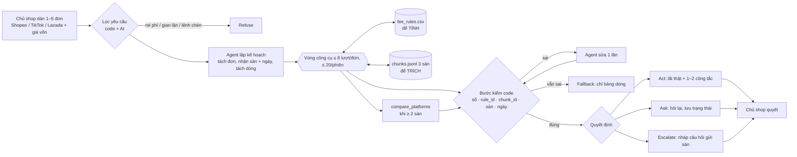

# AI SPEC — Lãi đi đâu? Agent soi đơn đa sàn (Shopee · TikTok Shop · Lazada) · Nhóm Hàllucinations · Lớp L3B · Phòng [XXX] · Zone [X]

> Mốc nộp: §7 chốt chuẩn "đạt" tại **CP2 19:30 Thứ Sáu 27/11** · §0–§7 nộp **CP3 10:00 Thứ Bảy 28/11** · đủ §0–§10 **CP4 14:30 Thứ Bảy 28/11** · §10 changelog ghi tiếp đến **23:59 Thứ Bảy 28/11**.
> Đầu mỗi mục ghi bước guide (`02-guide.md` trong repo đề) chỉ cách điền. Mỗi mục ngắn, có số và nguồn; chi tiết để ở file được trỏ tới. Xoá dòng hướng dẫn trong ngoặc vuông khi điền xong.

Track: [ ] A · [ ] B · [ ] C · [x] D · [ ] E — bài toán (nhóm tự mở rộng, hướng lợi nhuận phía người bán): chủ shop nhỏ bán cùng sản phẩm trên Shopee, TikTok Shop và Lazada bị trừ nhiều khoản trên từng đơn, mỗi sàn một biểu phí và mốc đổi phí riêng, nên không biết khoản nào bắt buộc, khoản nào là chương trình tự bật đang ăn lãi. Lát cắt: xem §4.
Data nền: `data/07_Ecommerce_Seller_Store.xlsx` (nguồn ngoài nhóm tự tìm, là data luyện tập giả lập; đã phân tích, không dùng làm đầu vào). Data chạy thử tự sinh có seed ở `data/synthetic/`, không tính là bằng chứng pain.

## §0. Hiện tại việc này diễn ra thế nào *(guide 1.1)*
- **Luồng hiện tại** (theo hướng dẫn công khai của sàn và các bài hướng dẫn người bán; nhóm không có tài khoản người bán nên **không có ảnh chụp**):
  1. Đơn giao xong, tiền về số dư người bán. Shopee: Kênh Người Bán › Tài chính › Doanh thu › Chi tiết › Đã thanh toán ([BigSeller](https://www.bigseller.com/blog/articleDetails/shopee-tra-tien-cho-nguoi-ban-khi-nao.4996.htm), [GHN](https://ghn.vn/blogs/tip-ban-hang/phi-thanh-toan-shopee-la-gi)). TikTok Shop và Lazada có màn tương tự (quyết toán / chi tiết giao dịch).
  2. Chủ shop mở từng đơn, thấy một danh sách khoản trừ: phí cố định, phí xử lý giao dịch (tên cũ "phí thanh toán"), Voucher Xtra, tiếp thị liên kết, phí hạ tầng, thuế khấu trừ, "phí khác"… Mỗi sàn đặt tên và tỉ lệ khác nhau.
  3. Muốn biết khoản nào đúng thì tự tra trang biểu phí, nhưng biểu phí đổi ít nhất 7 mốc từ 4 đến 8/2026 (`CONTEXT.md` › Thực trạng 2026). Cũng có thể tải báo cáo thu nhập (Excel) rồi tự cộng bằng tay.
  4. Thấy khoản lạ thì hỏi kênh hỗ trợ người bán. Review cho thấy nhân viên hỗ trợ thường không giải thích được (`evidence/summary.md`, trích dẫn 2).
  5. Tính lãi thật (trừ giá vốn) thì tự làm trên Excel, hoặc dùng công cụ báo cáo lãi tổng (BigSeller, Sapo).
- **Công cụ / AI đang được dùng:** báo cáo thu nhập của chính sàn (liệt kê khoản trừ, không giải thích); BigSeller Profit Report (lãi theo đơn và theo shop, [help center](https://help.bigseller.pro/en_US/detailPage/10/1/8346/content)); Sapo (quản lý bán hàng đa kênh, chưa kiểm tính năng lãi theo đơn). Chưa thấy công cụ nào gắn từng khoản trừ với luật phí tại ngày đặt đơn: *chưa kiểm hết, tìm trên web 27/11/2026*.

## §1. Người dùng & bằng chứng *(guide 1.1, 1.2)*
- **Người dùng chính:** chủ shop nhỏ (1–5 người) bán cùng sản phẩm trên Shopee, TikTok Shop và Lazada, tự đối chiếu tiền về từng đơn.
- **Việc họ cố làm xong:** kiểm xem tiền về của từng đơn vừa thanh toán có đúng không và đơn đó lãi thật bao nhiêu, ngay khi tiền về, trên từng sàn.
- **Hôm nay họ giải bằng gì, hỏng ở đâu, vì sao chưa bỏ:** mở chi tiết thanh toán, tự tra biểu phí, tự cộng trên Excel. Hỏng ở 3 chỗ: tên phí đổi, tỉ lệ đổi theo ngày, và không phân biệt được khoản bắt buộc với chương trình shop tự bật. Chưa bỏ vì không rời sàn được, và công cụ báo cáo lãi tổng chỉ cho con số tổng, không nói khoản nào sai hay nên tắt gì.
- **Pain:** chủ shop bán đa sàn mở chi tiết thanh toán từng đơn thấy bị trừ nhiều khoản, mỗi sàn một tên gọi, tỉ lệ và mốc đổi phí riêng. Họ không biết khoản nào bắt buộc, khoản nào là chương trình tự bật đang ăn lãi, nên tiếp tục bán những đơn lãi mỏng hoặc lỗ mà không biết.
- **Bằng chứng** (chi tiết: `evidence/summary.md`, `evidence/data-mining.md`): 88/900 review mới nhất của 3 app người bán (9,8%) là pain về tiền sau khi đọc lại; ước lượng ≈ 12,4% nếu tính cả phần từ khoá bỏ sót. Shopee cao nhất, 56/300 (18,7%), riêng phí sàn 44/300 (14,7%). Trong 88 review, phí sàn chiếm 62 (70,5%); 25 review (28,4%) nói rõ lỗ hoặc gần như không còn lãi. **Kết luận:** pain có thật và tập trung ở phí trên từng đơn. Review không đo được tỉ lệ người bán gặp pain.

## §2. Impact & quyết định chọn *(guide 1.3)*

| Hướng | Bao nhiêu người gặp | Bao nhiêu lần / tháng | Mỗi lần tốn gì | Impact / tháng | Làm kịp không | Chọn? |
|---|---|---|---|---|---|---|
| **A. Soi từng đơn đa sàn** ("Lãi đi đâu?"): gắn mỗi khoản trừ với luật phí, chỉ công tắc ăn lãi, so sàn | ~601.800 shop có đơn năm 2025 (Metric, theo `CONTEXT.md`; nhóm chưa dán link gốc) × 30% bán ≥ 2 sàn *(tự ước tính)* ≈ 180.000 shop | 8 lần soát đơn *(tự ước tính: 2 lần / tuần)* | 15 phút tra biểu phí và cộng Excel *(tự ước tính)*; thêm khoản bị trừ sai không phát hiện (review: đơn 180k bị trừ 51k) | ≈ 180.000 × 8 × 15 phút ≈ 360.000 giờ | Kịp: một agent, data giả có seed, bảng phí 3 sàn đã có | ☑ |
| B. Chẩn đoán lãi cuối tháng của cả shop (hướng bản 17:00) | Cùng tập shop | 1 lần / tháng | 1–2 giờ làm báo cáo *(tự ước tính)* | ≈ 180.000 × 1 × 90 phút ≈ 270.000 giờ | Kịp, nhưng BigSeller, Sapo đã làm | ☐ |
| C. Hỗ trợ tranh chấp hoàn hàng / bom hàng | 30/88 review pain về tiền nhắc hoàn trả (34,1%) | Theo số đơn hoàn *(chưa có số)* | 50–60k mỗi đơn hoàn theo lời review *(1 review, không đại diện)* | Chưa tính được | Không kịp: cần bằng chứng tranh chấp thật, quyết định thuộc sàn (ngoài thẩm quyền) | ☐ |

- **Impact / tháng** của hướng chọn = ~180.000 shop × 8 lần × 15 phút ≈ **360.000 giờ / tháng**. Nguồn từng thừa số: số shop 601.800 lấy từ `CONTEXT.md` (Metric, năm 2025); tỉ lệ bán ≥ 2 sàn 30%, 8 lần / tháng và 15 phút / lần đều là *(tự ước tính)*, cần 2–3 người bán dùng thử để kiểm lại (`validation/log.md`).
- **Hướng đã loại và vì sao:** B, vì phàn nàn trong review tập trung ở phí trên từng đơn chứ không ở báo cáo tổng, và BigSeller, Sapo đã có báo cáo lãi tổng. B được giữ lại thành phần demo bổ sung "import file export tháng" để chọn đơn đáng soi (§4). C, vì cần dữ liệu tranh chấp thật và quyết định cuối nằm ở sàn, AI không có thẩm quyền.
- **Số lần / tháng của từng kiểu người dùng** (cho persona §8, đều *(tự ước tính)*): shop nhỏ ít đơn soi 4 lần / tháng, mỗi lần 1 đơn; shop đang bán đều 8 lần, mỗi lần 1–3 đơn; shop bán cùng sản phẩm trên 3 sàn 8 lần, mỗi lần 3 đơn để so sàn.

## §3. Giải pháp tương tự *(guide 2.1)*
- **BigSeller Profit Report** ([help](https://help.bigseller.pro/en_US/detailPage/10/1/8346/content)): đáng học là công thức lãi rõ ràng (doanh thu đơn − giá vốn + phí khác) và đồng bộ đủ Shopee, TikTok Shop, Lazada. Đáng né là đơn thiếu giá vốn thì giá vốn ghi là 0, ra lãi ảo, và chỉ có số tổng, không nói khoản nào sai luật. **Mình khác:** thiếu giá vốn thì hỏi lại (Ask), và mỗi khoản trừ gắn với một luật phí có ngày hiệu lực và nguồn.
- **Sapo (bán hàng đa kênh):** đáng học là quản lý đơn của nhiều sàn ở một chỗ. Đáng né *(chưa kiểm chi tiết tính năng lãi)* là chỉ dừng ở báo cáo. **Mình khác:** không quản lý đơn, chỉ soi một vài đơn để quyết định tắt, giữ hay chỉnh chương trình nào.
- **Báo cáo thu nhập của chính sàn** (Shopee: Tài chính › Doanh thu): đáng học là đủ dòng, đúng tên khoản. Đáng né là không giải thích khoản nào bắt buộc, khoản nào do chương trình tự bật, và không so với biểu phí tại ngày đặt đơn. **Mình khác:** dùng đúng tên dòng của sàn (kể cả tên cũ), rồi gắn chip bắt buộc / công tắc / không khớp luật và soạn nháp câu hỏi gửi sàn.

## §4. Thiết kế *(guide 2.2, 3.2)*
- **Lát cắt MỘT CÂU** (1 người dùng · 1 việc · 1 quyết định AI · 1 kết quả): Một chủ shop nhỏ bán cùng sản phẩm trên Shopee, TikTok Shop và Lazada · dán chi tiết thanh toán của một hoặc vài đơn vừa về tiền (sàn nào cũng được) kèm giá vốn · agent quyết định mỗi khoản trừ thuộc luật phí nào của sàn đó tại ngày đặt đơn, công tắc nào đang ăn lãi, sàn nào lãi thật nhiều nhất, và có cần hỏi lại hay soạn nháp câu hỏi gửi sàn không · chủ shop biết lãi thật mỗi đơn, mỗi sàn và nên tắt, giữ hay chỉnh công tắc nào ở sàn nào.
- Không làm (≥3 điều): không tự tắt chương trình hay tự gửi gì cho sàn (chỉ soạn nháp) · không kết nối API / tài khoản sàn thật · không làm báo cáo lãi cả tháng (BigSeller, Sapo đã có) · không gợi ý né phí, né thuế, buff đơn, review ảo · không chat tự do ngoài phạm vi đơn đã dán.
- **Demo bổ sung (ngoài lát cắt, không tính vào §7):** import file export tháng của 3 sàn + file giá vốn → code (`data/import_export.py`) tính lãi theo sàn và SKU, liệt kê đơn lệch luật, công tắc ăn lãi, ROAS so với hoà vốn, rồi chủ shop chọn đơn đáng soi để đưa vào luồng agent ở trên. Dùng chung bảng phí và công cụ tính, không có metric hay câu thử riêng. Đây là danh sách đơn cần soi, không phải báo cáo lãi tổng.
- **Sơ đồ** (Mermaid):

- **Hình dạng:** [ ] workflow cố định · [x] một agent (có giới hạn) · [ ] nhiều agent — Đầu vào thay đổi theo từng lần (1–5 đơn, 3 sàn, tên phí cũ lẫn mới, dòng lạ, thiếu giá vốn) nên số bước và công cụ cần gọi khác nhau mỗi đơn; agent tự lập kế hoạch, chọn công cụ, hỏi lại có nhớ trạng thái và tự sửa sau bước kiểm. Mọi phép tính khoá cứng trong code. Không chọn nhiều agent vì không có việc nào cần chia vai riêng, chỉ thêm chi phí và chỗ hỏng. Workflow cố định chỉ dùng để cứu hộ nếu 23:30 T6 vòng agent chưa qua `eval --try` (vẫn giữ 3 sàn).
- **AI dựa vào đâu** — mỗi công cụ (khớp `codebase/tools.py`):

  | Công cụ | Input | Output | Tác động ra ngoài? |
  |---|---|---|---|
  | `check_lines_sum` | các dòng đã tách, tiền về | khớp / lệch bao nhiêu | Không |
  | `lookup_fee_rule` | tên phí (cả tên cũ), ngày đặt, loại shop, ngành, sàn | luật khớp (`rule_id`, loại, tỉ lệ, trần, hiệu lực, `chunk_id`, nguồn) hoặc `null` | Không |
  | `expected_amount` | `rule_id`, số tiền căn cứ | số đúng luật, độ lệch | Không |
  | `unit_profit` | giá, các dòng, giá vốn | tiền về, lãi thật, phần ăn lãi của từng công tắc | Không |
  | `switch_what_if` | dòng, công tắc, giá trị mới | lãi sau khi đổi; số đơn được phép giảm mà vẫn có lợi | Không |
  | `breakeven_roas` | biên lãi trước quảng cáo | 1 ÷ biên lãi | Không |
  | `compare_platforms` | các đơn cùng sản phẩm ở ≥ 2 sàn, giá vốn | lãi thật mỗi sàn, công tắc lớn nhất mỗi sàn, sàn lãi nhất | Không |
  | `ask_user` | câu hỏi | dừng lượt, lưu trạng thái phiên | Không |
  | `draft_platform_question` | đơn, dòng, số đúng luật, số bị trừ | nháp câu hỏi để chủ shop tự gửi | Chỉ soạn nháp, không gửi |
  | `search_policy` | câu hỏi, sàn, loại chính sách, k | ≤k đoạn chính sách chính thức kèm `chunk_id`, URL, ngày hiệu lực, điểm; `[]` khi không đủ gần | Không (đọc `data/<sàn>/policies/`, vd `data/tiktok_shop/policies/`, gọi API embedding cho câu hỏi) |

- **Mức tự động:** [x] AI gợi ý, người quyết · [ ] AI tự làm khi chắc, chuyển người khi không · [ ] AI tự làm — Tắt nhầm một chương trình đang có lợi hoặc khiếu nại sai với sàn đều đắt và khó sửa, nên agent chỉ phân tích, gợi ý và soạn nháp; chủ shop bấm thật.
- **Chỗ chặn rủi ro** (rủi ro lớn nhất của lát cắt bị chặn ở đâu, bằng gì): rủi ro lớn nhất là một con số sai hoặc trích nhầm luật của sàn khác → bước kiểm bằng code: mọi số trong câu trả lời có trong output công cụ (±0,1), mọi `rule_id`/`chunk_id` có thật, đúng sàn, đúng ngày hiệu lực; sai thì agent sửa 1 lần, vẫn sai thì chỉ trả bảng dòng. Công cụ tra luật và tìm chính sách lọc cứng theo `platform`.
- **Chỗ người duyệt** (việc AI không được tự làm): tắt / chỉnh chương trình (Voucher Xtra, tiếp thị liên kết, quảng cáo, voucher), gửi câu hỏi hay khiếu nại cho sàn, đổi giá bán.
- **Nguyên tắc thiết kế** (≥3, bắt buộc G10):

  | Nguyên tắc | Chỗ cụ thể trên sơ đồ / trong bản chạy thử |
  |---|---|
  | G10 — thu hẹp phạm vi khi không chắc | Thiếu giá vốn hoặc tổng không khớp → Ask; dòng không khớp luật nào → Escalate (nháp gửi sàn), không đoán |
  | Code tính, AI phán đoán | Mọi con số từ `fee_rules.csv` qua công cụ; agent chỉ chọn luật, công tắc, quyết định |
  | Minh bạch nguồn | Mỗi dòng kèm `rule_id`, `chunk_id`, link nguồn, ngày hiệu lực, cờ `da_doi_chieu` |

- Phần nào còn giả (công cụ trả dữ liệu giả, model chế độ giả…) — ghi rõ, không giả làm thật: đơn hàng là dữ liệu giả có seed (`data/synthetic/`); một số dòng trong `fee_rules.csv` chưa có nguồn chính thức (`da_doi_chieu=gia_dinh`); trước khi nối model thật, `agent.py` chạy với AI giả.

## §5. Chỗ khó — 4 lớp + ≥6 kịch bản + 2 tấn công *(guide 2.3)*

| Kịch bản | Lớp (1–4) | Hành vi mong muốn (nói gì, hiện gì, cho làm gì tiếp) | Câu thử |
|---|---|---|---|
|  |  |  |  |
| *(tấn công)* |  |  |  |
| *(tấn công)* |  |  |  |

(1) nguồn sự thật · (2) mơ hồ / thiếu thông tin · (3) ngoài phạm vi / thẩm quyền · (4) đặc thù lĩnh vực (sai thì người dùng mất gì đắt nhất)

## §6. Bốn đường đi của trải nghiệm
- Mọi thứ suôn sẻ: · Không chắc (lớp 2): · Không có căn cứ (lớp 1): · Người dùng sửa:
- Bị đòi ngoài phạm vi (lớp 3): · Trường hợp đặc thù lĩnh vực (lớp 4):

## §7. Đánh giá & chuẩn "đạt" *(guide 2.4, 4.1)*
- Data card: `data/DATA_CARD.md` · bộ câu thử: `eval/benchmark.csv` — 26 câu (thuong 16 · kho 6 · tu_choi 4) · metric: `eval/metric_spec.yaml` (11 metric: 3 thuộc chuẩn đạt + 8 phụ)
- **Chuẩn "đạt"** (chốt **trước 19:30 Thứ Sáu 27/11**, giữ nguyên đến 23:59 Thứ Bảy 28/11): "Đạt khi ≥ 90% dòng phí được gắn đúng luật, VÀ 100% con số trong câu trả lời khớp output công cụ, VÀ 100% câu `tu_choi` bị từ chối."
- Metric phụ (báo cáo, không thuộc chuẩn đạt; khớp `eval/metric_spec.yaml`): quyết định đúng (act / ask / escalate / refuse) ≥ 85% · gắn đúng luật **tách theo từng sàn** (Shopee · TikTok Shop · Lazada) · so chéo sàn chọn đúng sàn lãi nhất ≥ 80% · bắt dòng lệch ≥ 90% · truy xuất đúng đoạn trong top 5 ≥ 80% · hỏi lại khi thiếu dữ liệu 100% · công tắc khớp quy tắc code ≥ 80% · số lượt công cụ trung bình / đơn, tỉ lệ tự sửa thành công, tỉ lệ rơi về fallback.
- Bộ câu thử dự kiến 30 câu: ≥ 8 mỗi sàn, ≥ 3 so chéo sàn, ≥ 5 `kho`, ≥ 3 `tu_choi`, ≥ 1/3 câu theo lời review / YouTube.
- Kết quả: lượt 1 __/__ (__%) · lượt 2 __/__ (__%) — run ID: __ / __ → chi tiết `eval/report.md`, hồ sơ `eval/README.md`

## §8. Chi phí khi dùng thật *(guide 4.2)*
- Persona + giá: `cost/personas.yaml` · lượt mô phỏng: `cost/simulate-__.csv` (__ phiên)
- Chi phí / task thành công: __ (model __) · __ (model __)
- Chi phí / tháng ở quy mô thật: thấp __ · cơ sở __ · cao __ → chi tiết `cost/cost-estimate.md`
- So với impact / người / tháng (§2): đáng làm không, vì sao:

## §9. Rủi ro & an toàn
- Dữ liệu: đã ẩn danh gì, không thu gì, không đưa gì vào model gói miễn phí:
- AI **không được** làm gì kể cả khi người dùng yêu cầu:
- Ai có thể bị hại nếu AI sai, và nhóm chặn thế nào:

## §10. Phân công & changelog
- Phân công có tên (theo chặng, chia cặp — guide "Cách chia việc"): __
- Dùng AI vào việc gì (2–3 dòng; chi tiết `docs/ai-usage.md`):
- Nhật ký thay đổi — **mọi thay đổi sau CP2 19:30 Thứ Sáu 27/11 phải có dòng ở đây**:

**CP2 → CP4** (vd thu hẹp lát cắt, hỏi thêm người dùng, lần cải tiến trước lượt 2)

| Thời điểm | Đổi gì | Vì sao (trỏ về câu thử / lỗi / bằng chứng nào) |
|---|---|---|
| 22:10 T6 27/11 | §4 thêm dòng "Demo bổ sung": import file export tháng. Không đổi lát cắt, không đổi §7 | Shop bán cả 3 sàn thường có sẵn file export tháng; dùng để chọn đơn đáng soi khi demo. Có data mẫu `data/demo_import/` |
| 28/11 | §0–§3 điền lần đầu (HA-3): luồng hiện tại, người dùng, impact 3 hướng, giải pháp tương tự. Không đổi lát cắt, không đổi §7 | Số bằng chứng lấy từ `evidence/data-mining.md` (88/900 đã đọc lại); thừa số impact không có nguồn ghi *(tự ước tính)* |

**Sau CP4 (đến 23:59 Thứ Bảy 28/11)** (sửa theo góp ý — không sửa chuẩn "đạt", câu thử, số bằng chứng, kết quả các lượt đã chạy)

| Thời điểm | Đổi gì | Vì sao |
|---|---|---|
|  |  |  |
